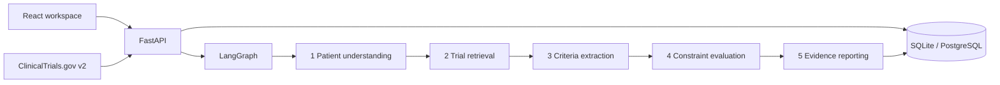

# TrialMatch AI

Production deployment: [TrialMatch AI on Vercel](https://trialmatch-ai-ten.vercel.app). Uses the connected Neon PostgreSQL database. A synthetic matching run and report persistence were verified on the hosted application. Vercel's existing deployment protection settings are preserved.

A local full-stack clinical research workspace combining patient profiles, hybrid trial retrieval, conservative eligibility checks, and evidence reports. React / Vite / TypeScript / Tailwind frontend; FastAPI / Pydantic / SQLAlchemy backend; five typed LangGraph agents; SQLite locally and PostgreSQL support.

**Research support only.** This software does not diagnose, prescribe, determine medical suitability, or enroll patients. A qualified clinical research professional must review the complete current protocol and make final eligibility decisions. Ranking scores are not eligibility probabilities. Initial patient profiles and trials are fictional and visibly marked synthetic.

## Quick start

Requires Python 3.12 and Node 22+ with pnpm 11 (or Corepack). Run from this repository root:

```powershell
python -m venv .venv
.\.venv\Scripts\python.exe -m pip install -r backend/requirements.lock.txt
cd frontend
pnpm install --frozen-lockfile
pnpm build
cd ..
.\scripts\start.ps1
```

Open http://127.0.0.1:8000. The same backend serves the built frontend and its client-side routes. API documentation: http://127.0.0.1:8000/docs. The startup script loads `.env` if present; copy `.env.example` to `.env` to configure providers. Development runs seed three synthetic patients and six fictional trials only when their respective tables are empty.

For frontend development, run `pnpm dev` inside `frontend` and run the API separately:

```powershell
.\.venv\Scripts\python.exe -m uvicorn app.main:app --app-dir backend --host 127.0.0.1 --port 8000 --reload
```

Vite proxies `/api` to port 8000. Open API docs at the backend URL during frontend development.

On Linux/macOS, use `python3.12 -m venv .venv`, `.venv/bin/python` in place of the Windows executable, export environment variables in the shell, and use the same uvicorn command. Dependency lock records were generated on Python 3.12 Windows; optional platform-specific integrations have separate dependencies.

## Working workflows

1. **Patient profiles:** create, edit, or delete a coded profile. Conditions, medications, allergies, sex, age, lab values with explicit units, and clinical notes are stored. Deleting a profile also deletes its saved matching runs.
2. **CSV import:** upload `samples/patients.csv`. Columns: `code, age, sex, conditions, medications, notes, synthetic`, plus optional `labs` containing a quoted JSON object. Separate list items with semicolons; use `female`, `male`, or `unknown` for sex. Imports validate all rows before writing; max 500 rows / 2 MB. History completeness is never assumed from CSV.
3. **Clinical documents:** in a saved profile upload a UTF-8 `.txt` note (20 KB max), replacing the existing note. Extracted dictionary mentions are unconfirmed suggestions. They never silently become structured diagnoses or lab measurements. PDF/OCR/document-format extraction is intentionally unsupported.
4. **Trial library:** add local trials or import up to 20 studies by condition from the official ClinicalTrials.gov API v2. Imports deduplicate by study ID. Full eligibility text, source URL, retrieval timestamp, locations, sponsor, phase, and recruitment status are retained. On an upstream failure the existing local library remains available; no registry records are invented.
5. **Matching:** select a profile and run the five-agent graph. Review criteria marked met, not met, or unknown and inspect full original source criteria. Non-recruiting/unknown recruitment states require review. Known conflicts are grouped after candidates without conflicts.
6. **Workflow & reports:** select saved runs to inspect actual timing and agent outputs. Download criterion evidence as CSV or the full patient snapshot, evidence, source metadata, and logs as JSON. CSV export escapes formula-triggering prefixes.

## Architecture and matching behavior



- Agent inputs/outputs use Pydantic models carried by a typed graph state. Each node records start time, duration, and a factual summary. The compiled LangGraph executes on every matching request.
- Patient normalization uses a deliberately bounded medical synonym dictionary (e.g. T2DM, NSCLC, CKD, HTN, metformin/Glucophage). Note mentions retain unconfirmed status because the baseline cannot reliably resolve negation, family history, or time.
- **Default offline retrieval:** synonym-normalized TF-IDF cosine similarity (70%) plus normalized BM25 (30%). This is a statistical baseline with medical synonym expansion, not a pretrained clinical language model. It needs no API key or model download.
- **Optional semantic retrieval:** Sentence Transformers normalized embeddings replace TF-IDF; BM25 remains. NumPy or FAISS handles exact vector similarity. The index is built in memory per matching run from durable database trial records; it is not a persistent distributed vector service.
- Extraction supports explicit age/sex fields, straightforward numeric age/HbA1c/eGFR/BMI comparisons, and bounded condition/medication declarations under inclusion/exclusion headings. Original text is preserved. Compound clauses, temporal rules, stage criteria, negation, and unsupported text remain unknown for human interpretation. Logical/temporal NLP is conservative rather than a claim of complete clinical reasoning.
- The evaluator never treats missing data or incompatible units as a pass. Absence of a diagnosis/medication is unknown unless history is explicitly confirmed complete. Exclusion predicates are inverted: a present exclusion is a conflict.
- Ranking score = `100 × (0.45 × retrieval_similarity + 0.55 × met_criteria / all_criteria)`. This uncalibrated heuristic supports review prioritization. There is no diagnostic or enrollment outcome.
- The optional LLM adapter is an explicit API action for **trial text only**, disabled by default. Structured Pydantic-validated suggestions are always inferred/review-required and never replace deterministic checks automatically. Patient notes are not sent to the LLM.

## Provider configuration

Install optional ML dependencies before enabling a model:

```powershell
.\.venv\Scripts\python.exe -m pip install -r backend/requirements-ml.txt
```

| Variable | Default | Supported values / purpose |
| --- | --- | --- |
| `DATABASE_URL` | `sqlite:///./trialmatch.db` | SQLAlchemy URL; PostgreSQL uses `postgresql+psycopg://...` |
| `EMBEDDING_PROVIDER` | `local` | `local` or `sentence_transformers` |
| `EMBEDDING_MODEL` | `sentence-transformers/all-MiniLM-L6-v2` | Hugging Face model ID; downloaded on first use |
| `VECTOR_PROVIDER` | `numpy` | `numpy` or `faiss` with Sentence Transformers |
| `LLM_PROVIDER` | `none` | `none` or `openai_compatible` |
| `LLM_BASE_URL` | `https://api.openai.com/v1` | Chat-completions-compatible endpoint |
| `LLM_MODEL`, `LLM_API_KEY` | unset | Required for explicit LLM suggestions |
| `CORS_ORIGINS` | localhost:5173 origins | Comma-separated allowed frontend origins |

Settings displays active provider configuration. Environment variables are server-side; credentials never enter frontend bundles. The general-purpose default embedding model is not clinically validated. SciSpaCy is not included because its model compatibility varies; a clinical normalization pipeline requires separate evaluation.

## Database and containers

### Vercel

The repository root contains `vercel.json`, `app.py`, `.python-version`, and runtime `requirements.txt`. Deploy the **repository root**, not the frontend subdirectory. Vercel runs the FastAPI app and the build command installs/builds the React frontend, which FastAPI serves on the same domain. There is no cross-origin backend URL to configure.

Before deployment, configure `DATABASE_URL` with a managed PostgreSQL connection string (for example a Neon pooled connection from the Vercel Marketplace). `postgres://` and `postgresql://` URLs automatically use psycopg. Set `EMBEDDING_PROVIDER=local` and `LLM_PROVIDER=none` for the lightweight baseline. The app deliberately refuses to start on Vercel with local SQLite: serverless local storage is not durable. No local database, notes, secrets, or uploaded records are included in the deployment upload.

After signing into Vercel CLI, deploy from the repository root with `vercel --prod`. A new hosted database initializes the synthetic demonstration records on startup. This app currently has no user authentication, so a public deployment is suitable only as a synthetic-data demonstration. Optional embedding models should run in a separate service if they exceed the function's memory or bundle limits.

Deployment instructions follow [Vercel's FastAPI deployment documentation](https://vercel.com/docs/frameworks/backend/fastapi) and [Python runtime configuration](https://vercel.com/docs/functions/runtimes/python). A deployment URL is only available after Vercel authentication and a successful remote deployment; configuration files alone do not publish the app.

SQLite file is created in the current working directory. ORM tables are initialized automatically for local convenience. Initial Alembic migration is provided:

```powershell
.\.venv\Scripts\python.exe -m alembic upgrade head
```

Run this on an empty database before application startup. For an existing unchanged schema created by local startup, use `alembic stamp head` after verifying schema equivalence; do not run the initial create migration over existing tables.

`docker compose up --build` provides the application and PostgreSQL with a persistent volume. Compose credentials are local development examples. The app binds only to loopback on the host. The image runs as a non-root user. This configuration is a development deployment, not an approved clinical production environment.

## Verification

```powershell
.\.venv\Scripts\python.exe -m pytest -q
cd frontend
pnpm build
```

Tests cover boundary values, unit mismatches, unknown exclusions, unconfirmed note mentions, temporal/compound review flags, LangGraph execution, CRUD, atomic CSV imports, note uploads, exports, registry outage fallback, and deduplication. Live registry access and optional model providers depend on network/model availability. Docker/PostgreSQL and heavyweight optional models require separate environment verification.

## Repository

- `backend/app/`: API, ORM, schemas, terminology NLP, retrieval, criteria checks, providers, LangGraph nodes, and synthetic seed records.
- `backend/tests/`: isolated API and matching tests.
- `backend/migrations/`: Alembic schema.
- `frontend/src/`: React workspace, typed API data, charts, and React Flow visualization.
- `samples/`: synthetic import examples.
- `scripts/start.ps1`: local single-server launcher.

## Scope and deployment limits

The supplied prompt ends at `## Agent`; later agent definitions were unavailable. Agents 4 and 5 complete the described constraint/evidence workflow. This implementation is a runnable research prototype, not a clinically validated matching system. It has no authentication, multi-user authorization, immutable compliance audit trail, encryption/key management, or protected-health-information deployment controls. Use synthetic/de-identified development data. Clinical validation, terminology licensing, security review, and access controls are prerequisites to handling identifiable records.

Sources: [ClinicalTrials.gov API information](https://www.nlm.nih.gov/pubs/techbull/ja25/ja25_clinical_trials_screen-scraping.html), [LangGraph StateGraph reference](https://reference.langchain.com/python/langgraph/graph).
